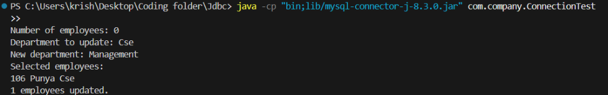
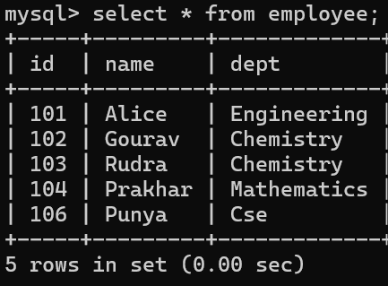
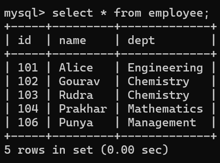

# JDBC Employee Management & Transaction Processing

A Java application demonstrating relational database connectivity using **Java Database Connectivity (JDBC)** with **MySQL Connector/J**.

---

## 📸 Output & Execution Screenshots

### 1. Terminal Execution
Running the program, entering inputs, querying records, and updating the department:



---

### 2. Database Verification (MySQL Server)

| Before Transaction (Initial State) | After Transaction (Committed State) |
| :---------------------------------: | :----------------------------------: |
|  |  |
| *Record `106 (Punya)` assigned to `Cse`* | *Record `106 (Punya)` updated to `Management`* |

---

## ⚡ Brief Code Explanation

The program is contained in `ConnectionTest.java` and executes through the following steps:

1. **Database Connection (`DBConnection`)**:
   - Loads the MySQL driver (`com.mysql.cj.jdbc.Driver`) in a static block.
   - Connects to the local `company` database using `DriverManager.getConnection()`.

2. **Table Creation (DDL)**:
   - Executes `CREATE TABLE IF NOT EXISTS employee` to set up columns: `id` (PRIMARY KEY), `name`, and `dept`.

3. **Data Insertion (`PreparedStatement`)**:
   - Takes `n` employee records from terminal input.
   - Inserts each record using parameterized queries (`INSERT INTO employee VALUES(?,?,?)`) to safely prevent SQL injection.

4. **Querying Records (`ResultSet`)**:
   - Prompts for a target department (e.g., `Cse`).
   - Runs `SELECT * FROM employee WHERE dept=?` and iterates through the `ResultSet` cursor to print matching rows.

5. **Transaction Management (`commit` / `rollback`)**:
   - Calls `con.setAutoCommit(false)` to start an explicit atomic transaction.
   - Executes `UPDATE employee SET dept=? WHERE dept=?`.
   - **`con.commit()`**: Permanently saves the update if successful.
   - **`con.rollback()`**: Cancels all changes if an exception occurs, preserving data integrity.

6. **Automatic Resource Cleanup**:
   - Uses Java's **try-with-resources** to ensure `Connection`, `Statement`, `ResultSet`, and `Scanner` are closed automatically, preventing resource and connection leaks.

---

## 🛠️ How to Run

### 1. Compile
```powershell
javac -d bin -cp "lib/mysql-connector-j-8.3.0.jar" src/com/company/ConnectionTest.java
```

### 2. Run
```powershell
java -cp "bin;lib/mysql-connector-j-8.3.0.jar" com.company.ConnectionTest
```
